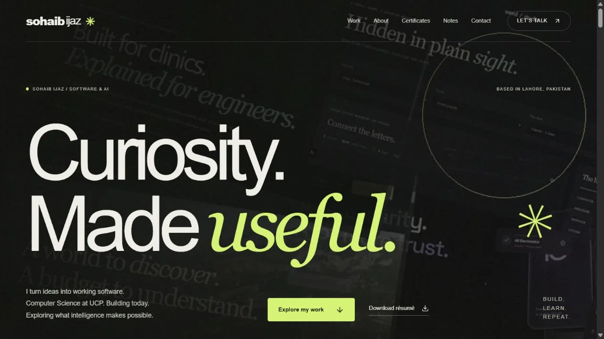

# Sohaib Ijaz — Engineering Portfolio


A responsive engineering portfolio and the shared source for four interactive project demos. Built by **Sohaib Ijaz**, a BS Computer Science student at the University of Central Punjab, Lahore (expected graduation: 2027).

**Status:** working local demonstrations; public hosting and a production domain are not configured yet. The source is public for inspection. Do not mistake sample data, synthetic accounts or planning estimates for live commercial services.

## Explore the projects

| Project | Modern edition | Foundation |
| --- | --- | --- |
| **TrustMart** | React/TypeScript + Flask/SQLite market companion: QR shop lookup, comparable sample prices, supplier/admin workflows and product disclosures | [Original React coursework](https://github.com/sohaibijaz940/trustmart-project) and the retained MIT App Inventor prototype |
| **Travel Estimator** | Explainable budgets, configured flight/venue providers, private group itineraries and expense splits | [Original MySQL coursework](https://github.com/sohaibijaz940/dynamic-travel-cost-estimator) |
| **CareIndex** | Synthetic clinic workflows, role-based access, transactional booking/invoicing and an AVL learning lab | [Original C++ AVL tree](https://github.com/sohaibijaz940/Patient-Record-AVL-Tree) |
| **Word Search Studio** | Reproducible seeded puzzles, original boards, local progress and visible algorithm traces | [Original C++ game](https://github.com/sohaibijaz940/wordsearchgame) |

### Portfolio experience

GSAP scroll animation and a desktop horizontal project gallery; responsive vertical mobile layouts; dark and warm-ivory light themes with a remembered preference; a fine-pointer cursor/spotlight with reduced-motion fallbacks; nine certificate documents with available issuer links; and six engineering articles with working teaching examples. Four short explainers include synthetic English narration, selectable English captions, chapters and transcripts.




## Run locally

Use **Node.js 24**, npm, **Python 3.12+** and a current browser. No PostgreSQL/MySQL server is required for these modern demo editions; they use documented local SQLite databases. Node 24 is needed for the built-in SQLite API.

```sh
git clone https://github.com/sohaibijaz940/sohaib-engineering-portfolio.git
cd sohaib-engineering-portfolio
npm ci
npm run setup:careindex
npm run dev -- --port 3001
```

Open [the portfolio](http://localhost:3001/). The setup command creates private local configuration; review the generated settings before enabling opt-in synthetic recruiter accounts. See the [recruiter guide](docs/RECRUITER_DEMO_GUIDE.md).

| Local route | Purpose |
| --- | --- |
| `/` | Portfolio, certificates and contact |
| `/demos/travel/` | Travel workspace |
| `/demos/careindex/tour/` | CareIndex guided entry |
| `/demos/word-search/` | Playable game |
| `/demos/avl-tree/` | Algorithm lab |
| `/writing/` | Six illustrated engineering articles |
| `/demos/trustmart/` | Entry to the separate TrustMart service |

### Start TrustMart separately

In another terminal:

```sh
cd trustmart-app
python -m venv .venv
# Windows PowerShell:
.\.venv\Scripts\python.exe -m pip install -r requirements.txt
npm ci
npm run build
.\.venv\Scripts\python.exe backend/server.py
```

Open [TrustMart](http://localhost:8000/). On macOS/Linux use `.venv/bin/python` for the Python commands, or the supplied startup script. The backend seeds fictional records on first use. See [TrustMart setup, demo accounts and boundaries](trustmart-app/README.md).

## Optional providers and credentials

No provider key is required to browse the portfolio, play the game, use the teaching labs or explore labelled sample estimates. Live integrations need **separate server-side credentials**:

- FlightAPI: live flight searches, with route coverage and a local quota safeguard.
- Google Places: venue information; billing/fields/coverage determine returned photos and reviews.
- Ticketmaster: optional current events where available.
- Google OAuth: TrustMart consumer sign-in; use the callback documented in its setup guide.
- Gemini: TrustMart's app-scoped assistant. It is independent of Google OAuth credentials.

Copy example configuration to private local files only. Never commit real keys, OAuth secrets, databases or genuine patient information. See [Travel provider setup](docs/travel/PROVIDERS.md), [discovery setup](docs/travel/DISCOVERY_SETUP.md) and [security notes](SECURITY.md).

## Verify

```sh
npm run typecheck
npm run test:travel
npm run test:word-search
npm run test:avl
npm run test:careindex
npm run test:writing
npm run build
```

From `trustmart-app`, run `python -m unittest discover -s backend -p 'test_*.py'`. These tests exercise local logic and controlled fixtures; they do not establish production readiness or real-world supplier authenticity.

## Source map

```text
src/components/portfolio/  Portfolio motion, previews, theme and pointer
src/content/writing/      Six MDX articles
src/components/writing/   Diagrams, examples and captioned video player
src/app/demos/            Next.js demo pages
src/app/api/              Permission-checked server endpoints
src/lib/                  Calculation and algorithm engines
src/server/               Database access and provider connectors
trustmart-app/            Standalone React/Flask application
tests/                    Engine, permission and calculation checks
public/                   Interface captures, media and public credentials
docs/                     Architecture, setup, provenance and limitations
```

## Provenance and limits

Original repositories and their histories remain intact. They describe the coursework foundations; this repository contains the modern shared browser editions. Large local coursework archives and recovery copies are deliberately excluded from this source repository; original files remain in their existing repositories and the owner's local archive.

TrustMart's shops and prices are fictional, verification is not a product-authenticity guarantee, and there is no checkout or compensation promise. Travel does not book or charge; estimates and assumptions remain labelled. CareIndex contains synthetic records and simulated billing. Word Search records are local, not a verified global leaderboard. Public deployment requires HTTPS, persistent database storage, correct OAuth callbacks and provider configuration; a domain alone does not host the applications.

Media attribution: [Travel asset credits](docs/travel/ASSET_CREDITS.md). Portfolio films use actual application captures and labelled explanatory diagrams. Certificate scans are the owner's public professional documents; documents without issuer URLs are not presented as independently verified. [Writing maintenance](docs/portfolio/WRITING.md).
